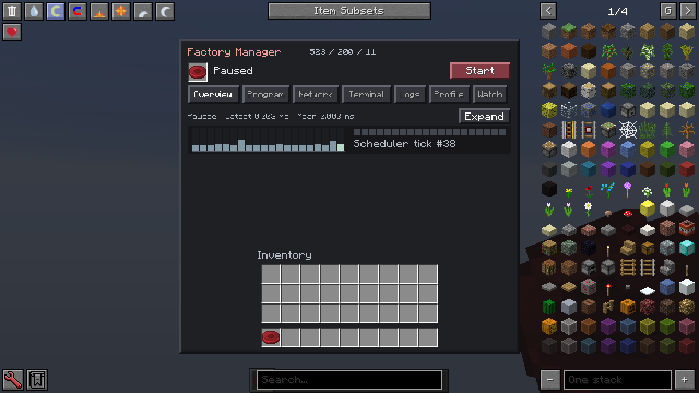
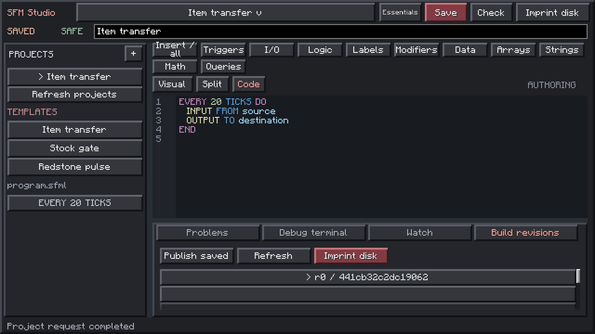

# Machine and Studio interface qualification

Checked 2026-10-30. The native MUI2 redesign is implemented, with usage described
in [Studio](STUDIO.md) and next work in the [roadmap](STUDIO_ROADMAP.md).

## Checked behavior

The final clean public source build passed compilation, formatting, Checkstyle,
the compiler bridge and GuideNH packaging: 1,269 tests total, 1,254 passed and 15
optional/environment skips. Focused tests cover profiler limits/percentiles,
nonmutating initialized-value inspection, reference source-author fences,
remembered-project file bounds/scoping/restart, usable templates and GUI geometry.

Two separate disposable native clients used the same frozen development SFM JAR,
MUI2 2.3.93, NEI and Backhand, with Java 8/LWJGL2 and a 2 GiB heap. One installed
Dynamic Inventory; the other omitted it entirely. Native checked flows:

- Centered 312 px machine, 232 px high on 320 x 240 and 288 px high where space allows.
  Standalone SFM has 36 player slots plus its equipment disk. NEI stays visible
  around the machine at 640 x 360 logical size.
- With Dynamic Inventory, all 72 storage slots plus nine hotbar slots remain
  bound; the inventory stays three visible rows and its final storage slot is
  reachable by scrolling. No SFM-owned allocation/split controls are present.
- Inline Terminal/Profile/Watch/Logs preserve the machine and player inventory.
  A 20-update profile auto-stops; live global snapshots change while the program
  runs. Retained multiline logs render with scrolling/wrapping and local filters.
- A template can be saved, checked and published through real station requests.
  The selected exact build imprints one fresh physical held disk in both variants.
  No development-only reference UI flag is supplied.
- Closing/reopening Studio loads the last selected saved project directly.
  Native synthetic pointer drags move the project sidebar and bottom dock;
  the source remains in its project. Compact 320 x 240 layout remains inside bounds.
- Studio shows projects/templates, saved/draft and safe state, Essentials/Advanced
  tools, categorized insert/API access, authoring views and bottom diagnostics.
  It has no accessible player-inventory/NEI surface.

The optional compact-host policy is implemented in Dynamic Inventory, identified
by screen owner and panel name. SFM uses ordinary MUI2 bindings/widgets and does
not link to the inventory mod's API.

## Scope

This is scoped native development-client evidence, not a full daily-803 Java 17/
LWJGL3, hardware/IME or simultaneous multiplayer qualification of the new layout.
Earlier cooperative reference lifecycle checks are [recorded separately](MULTIPLAYER_QUALIFICATION.md).
Per-statement tracing, expired local-variable inspection and breakpoints remain
planned. Profile numbers describe the selected controller's full update path,
not whole-server TPS, transferred quantities or an original-port speedup.

The ordinary production JAR excludes performance-fixture classes. Private worlds,
launch settings, inventories, grants, transcripts and audit ancestry are not
published. Native images above use purpose-built disposable fixtures.
