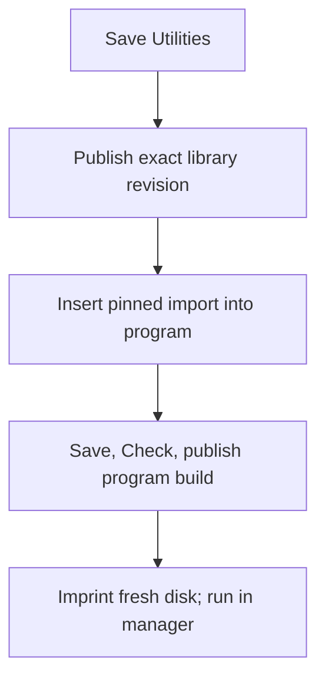

---
navigation:
  title: "Reusable functions"
  parent: /advanced/index.md
  position: 4
  icon: "superfactorymanager:programmingStation"
  keywords: ["library", "import", "functions", "namespace", "revision"]
categories: ["sfm", "advanced"]
updated: "2026-11-01"
---

# Reusable functions

Save useful functions once, then use an exact published revision in your other
programs. Start with [ordinary functions](/language/functions.md) first.

## 1. Save a function library

Create a Studio project named **Utilities**. Its source contains only functions:

```sfml
integer twice(integer value) {
  return value * 2
}
```

Leave out `name`, top-level `let`/`state`, imports and triggers. The Studio project
name is separate from the source. Save, then choose **Publish library** in Settings.
Publishing freezes that saved revision; it does not overwrite an older library.

## 2. Insert it into a program

Open the program that needs the function. Choose **Insert library**, select your
library project and published revision, and choose an alias such as `util`.
The picker inserts its exact import header. Call the function as `util.twice(21)`.

The shape below is explanatory; the picker fills in the real ID and digest:

```text
import util from "<project UUID>" revision 0 digest "<exact digest>"
state answer = 0
every 20 ticks {
  answer = util.twice(21)
}
```

Put imports after an optional `name` line and before declarations and functions.
Save and use **Check** to validate the linked server revision. Local/offline
checking cannot resolve private libraries. Library programs stay in Code when
Visual cannot preserve their constructs.

## 3. Imprint a build

Build/publish the saved program and imprint the selected build as usual. That
build contains the exact library source it was checked with. Editing Utilities
or publishing another revision cannot change this build or a running manager.
Choose a new import revision and build again when you want to update.



**Expected:** the imported example sets `answer` to 42. The running build keeps
that result if you later edit `twice`; select the new revision and publish a new
program build to deploy the change. See [Studio](/advanced/studio.md) for the
disk and publication controls.

## Rules to remember

- This first library feature supports **your own functions-only libraries**.
  Cross-player sharing, constants and imports inside libraries are separate work.
- Aliases and function names are case-sensitive. An alias is a namespace, not a
  label or a variable; do not reuse it for a root variable or function namespace.
- Library functions see their parameters, locals, own functions and built-ins.
  They cannot implicitly read your program's STATE, globals or private functions.
  Pass values or explicit writable `ref` arguments instead.
- WAIT and REF keep their normal rules. Each manager gets its own live values,
  rotations and sleeping calls. All functions share the usual invocation bounds.
- At most eight library revisions and 120,000 UTF-8 source bytes fit in a linked
  build, including the root. Every individual source remains limited to 30,000
  bytes. Function, type, loop, query and invocation limits still apply together.
- Runtime errors name the library alias, revision and library coordinates.
  They do not select an unrelated line in your root program.

Keep the world's `sfm` directory in backups. Reference disks do not carry program
or library bodies. Existing closed builds can run without the authoring library
artifact, but missing/corrupt build storage pauses activation instead of using
another revision.
