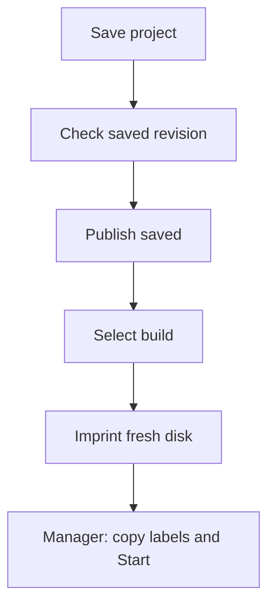

---
navigation:
  title: "Studio and published builds"
  position: 60
  icon: "superfactorymanager:programmingStation"
  parent: /advanced/index.md
  keywords: ["programming station", "studio", "project", "publish", "imprint", "recovery"]
categories: ["sfm"]
updated: "2026-11-01"
---

# Studio and published builds

A Programming Station opens **SFM Studio**, your full-screen workspace for named
projects. Projects belong to your player UUID and live in world storage; another
station can open them even if the first station is broken.

## Save a project and run its build

Hold **one fresh blank SFM disk** before opening Studio. A fresh disk has no
program, labels, STATE, recovery or custom metadata. Create a project with **+**
or a template, name it, and write or paste its SFML.

The diagram shows deployment steps. Editing or publishing alone never changes a Manager:

1. Choose **Save** and wait for confirmation. An unfinished draft can be saved.
2. Choose **Check** to validate that exact saved revision. Save changed text first.
3. Open the bottom **Build revisions** dock and choose **Publish saved**.
   Invalid drafts cannot be published.
4. Select the desired build row, then press the dock's **Imprint disk** button.
   The top Imprint disk entry also opens this build workflow.
5. Insert the disk into a Manager, copy labels from your Label Gun and press **Start**.

**Expected:** the Manager runs the selected published program. Later project edits
and new publications do not change that disk. Deploy a different build on a fresh disk.
After an uncertain imprint reply, inspect the held disk before retrying.

**Refresh** lists builds; **Copy digest** copies the selected build's identity.
You may select an older publication. Unsaved edits are never included. A digest
or execution disk does not grant another player access to your private source.
For shared code across your projects, use [your own function libraries](libraries.md).

## Arrange your workspace

Projects/templates occupy the left column. The full-width **Insert** bar opens
the searchable statement/example catalog. **Visual / Split / Code** chooses the
authoring view; Split needs at least 640 logical pixels. Drag the project,
Split or bottom-dock divider to change their balance.

Use Code for the full language. Visual supports the [documented graph subset](editors.md);
unsupported text remains intact in Code. Disconnected graphs retain their last
safe source and block Save. [Fields](routing-fields.md) keeps edits pending until
Apply; finish or cancel them before changing the document.

**Settings** chooses Essentials/Advanced tools and **Studio scale**. Use -/+ to
change Studio's scale; **Game** follows Minecraft's GUI scale. Studio remembers
this independently of the Manager and HUD. Small windows temporarily fit the
chosen scale. Resizing preserves the draft, Undo and pending fields. Settings
and unsaved-draft dialogs can be moved by their title bars.

Studio has no player inventory, hotbar actions or NEI. The Manager is a separate
centered machine window with normal inventory and operational pages.

## Complete code and fix errors

| Control | Use |
| --- | --- |
| Ctrl+Space | Suggest functions, methods or visible variables at the caret. |
| Up/Down / Page keys | Choose a completion; Enter inserts, Escape cancels. |
| Tab / Shift+Tab | Move between inserted snippet placeholders. |
| Ctrl+F / Ctrl+H | Literal Find / Replace; Replace All is one undo step. |
| Ctrl+Z / Ctrl+Y | Undo / redo on the active surface. |
| F4 | Jump to a current compiler problem. |
| API / hover a call | Find signatures and help. |

Gray inline completions can appear after a typing pause; Tab accepts and Escape
dismisses. Suggestions do not guarantee type or scope correctness. Draft checks
run after typing settles. **Problems** wraps each issue with location and source;
click an issue or use arrows/Enter to jump. **Check** still validates the exact
saved server revision. Validation never executes the project.

## Inspect a running Manager

The bottom dock has **Problems**, **Debug terminal**, **Watch** and **Build revisions**.
In Debug terminal, explicitly connect to a nearby loaded Manager by X/Y/Z.
Use `help`, `status`, `error`, `state`, `labels` or `logs`. Enable PRINT capture
explicitly to collect its output; capture starts off. Results support paging and
Copy. Tab completes commands; Up/Down recalls history.

**Errors** reads that Manager's retained runtime failure. Its location belongs to
the installed revision, which may differ from this draft. **Problems** instead
shows draft compiler diagnostics. `error clear` clears the retained failure
without clearing PRINT or ordinary logs. Pause/Run retains it; source edits,
resets, disk changes and Manager unload clear it.

**Watch** reads initialized program-wide LET and STATE. Trigger/function locals
are unavailable after execution. Reference-disk variable and failure details are
restricted to the verified source author; deliberate PRINT output remains
available to execution-disk holders.

Replacing or unloading the target ends the connection. These tools neither run
the open draft nor evaluate arbitrary SFML. For logs, profiling and diagnosis,
see [debugging](/reference/debugging.md) and [performance](/reference/performance.md).

## Restore a build or recover a draft

To reuse older source, select a published revision in Build revisions and choose
**Restore** / **Restore to draft**. Keep or discard current unsaved work when
prompted. Restored code becomes one undoable local edit; the current project
name and saved revision remain. Save, Check and publish normally to deploy it.
Only the owner can recover source. A late loading reply preserves newer edits.

When switching away, **Keep draft & continue** retains temporary source, graph
and pending Fields for that project. **Discard draft & continue** removes those
unsaved changes and recovery copy; saved projects and publications remain.
Unconfirmed requests must settle before discarding. Copy valuable text before
reconciling a failed or stale save.

**Local recovery does not survive world unload or client restart.** Save
important work before leaving; finish an incomplete graph before ending the session.
Reopening Studio remembers your last project for this world/server and player,
with a retained dirty draft taking priority.

## Back up projects and reference builds

Include the world's `sfm/projects`, `sfm/programs` and `sfm/execution-grants`
directories in backups. Reference disks carry a build reference; source remains
in world storage. Each physical disk keeps independent STATE. Existing closed
builds can run without the authoring library artifact, but need their build storage.

The Manager loads reference programs in the background while retaining pause
intent. Temporary loading-capacity waits retry automatically. Missing or invalid
builds preserve the disk and allow an explicit Start retry after repair. The
station never silently converts or erases an existing disk. Ordinary source disks
remain supported and can be edited directly in the Manager.

Projects allow 30,000 UTF-8 source bytes, 96 name bytes and up to 128 projects per
owner. Non-ASCII text can use several bytes per character. If Studio reports
busy or an old revision, wait for the current request or reopen the saved project.

Next: [editor controls](editors.md), [libraries](libraries.md), or [feature status](/reference/status.md).
