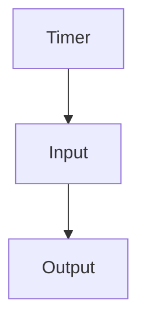
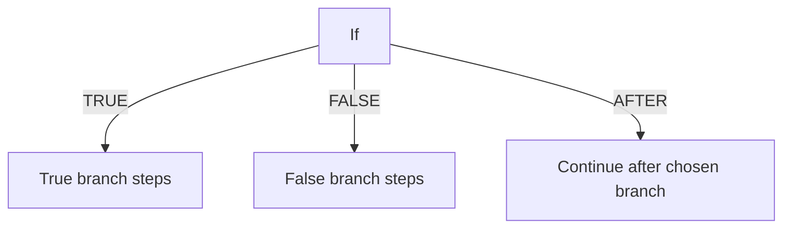
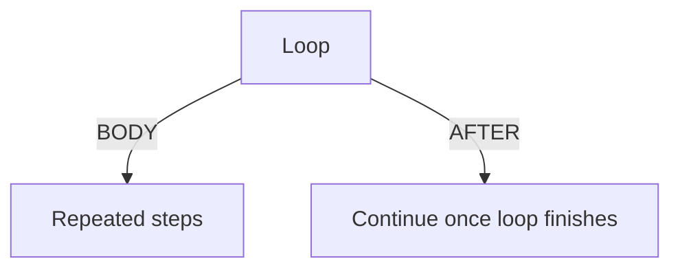

---
navigation:
  title: "Build and wire a graph"
  position: 20
  icon: "superfactorymanager:manager"
  parent: /advanced/editors.md
  keywords: ["visual", "graph", "pins", "loop", "reveal", "fields"]
categories: ["sfm"]
updated: "2026-11-01"
---

# Build and wire a graph

Start with the connected, labelled chests from [your first transfer](/start/first-transfer.md).
Keep that tutorial's program installed and open **Manager > Program > Visual**.
For Studio, paste the same complete program into a project, Save/Check it, then
choose **Visual**.
Studio's **Split** view shows code beside the graph when enough space is available.

## Make the first route

The imported program already has Timer, Input and Output nodes. Reuse those
three nodes for this exercise, keeping their existing connections. Select each
one to inspect its clause. The arrows below show execution order, not cables:



| Node | Clause to enter |
| --- | --- |
| Timer | `every 20 ticks` |
| Input | `input from "source"` |
| Output | `output retain 1 to "dest"` |

Trigger fields omit block delimiters. Statement fields hold complete clauses.
Apply each edit, inspect the generated source, then save. Press Start in the Manager.

**Expected:** with eight matching items in source and an empty destination, the
next due run leaves seven in source and one in dest. Further runs add nothing
until that destination item is removed. The graph runs the same SFML as the text tutorial.

## Move around the canvas

Drag node headers to move them. Click pins to connect; right-click a pin to
disconnect. Every executable node must connect to a trigger. Triggers have no
incoming wires; program-wide LET and STATE declarations are separate roots.
Cycles are rejected. Delete removes a selected node while its text field is unfocused.

| Surface | Pan / zoom / add |
| --- | --- |
| Studio | Middle-drag to pan; wheel to zoom; F to fit; right-click empty canvas to add. |
| Manager Visual | Right- or middle-drag empty canvas to pan; wheel to zoom. |

Studio's palette scrolls above its fixed footer. Preview/Copy lets you inspect
or copy generated SFML where offered. Undo retains bounded editing history.
Disconnected graphs keep their last safe source and block Save until repaired.

## Wire a condition

An If node has **TRUE**, **FALSE** and **AFTER** outputs. Connect the chosen
branch steps to TRUE or FALSE; use AFTER for work that follows either branch.
Nested ordinary If nodes are supported. Direct ELSE IF chains require Code.



These are three output-pin connections. Execution finishes the selected branch
before following AFTER. Leave the branch ends unwired; the If node handles that
continuation. An empty branch simply has no steps.

A condition field omits IF/THEN/END. For example:

```text
"source" HAS >= 1 item:minecraft:iron_ingot
```

Typed conditions use parentheses:

```text
(LABEL("source").available() AND NOT LABEL("source").empty())
```

Simple HAS fields offer labels, a comparison, a literal threshold and resource
rows. Computed thresholds and typed predicates use the Condition field.
Apply checks the complete condition and program; editing never queries containers
or executes transfers. See [routing fields](routing-fields.md) for pending changes.

## Add values and loops

Program value (LET) and Persistent state (STATE) are standalone roots without
wires. Local value and Set value follow execution connections. Fields edits
names and expressions; the complete program checks their types and scope.

Loop cards have **BODY** and **AFTER** pins. BODY repeats; AFTER continues once
the loop finishes. Repetition is implicit: do not draw a wire back to the loop.



Connect the last repeated step only to further steps inside BODY, if needed.
Leave its final output unwired. The loop repeats that body automatically;
a backward repetition wire would create a rejected cycle.

Counted loops use inclusive bounds; array loops capture their sequence; while
loops recheck the condition. Normal work limits apply. Counted and array-loop binders
are read-only; a Java-style FOR initializer declared with LET is mutable.

**For loop** edits a complete `for (initialize; test; update)` header.
**Indexed array loop** edits index name, element name and sequence separately.
See [loops](/language/loops.md) for scope and syntax. WAIT and BREAK require Code.

## Jump between source and nodes

**Go > Reveal node** (F6) finds the instruction/header at the code caret.
**Go > Reveal source** (Shift+F6) selects the current node's source. Wide layouts
also have direct buttons. Split remains open when usable; narrower layouts show
the target in Visual or Code. Ordinary typing and selection never switch views.

Comments, whitespace, NAME, ELSE and END have no node: move onto an instruction.
Apply/Cancel pending Fields or Apply/Reset a raw clause before revealing.
Incomplete graphs, unsupported code, active gestures/wires and project requests
can prevent navigation. Reveal preserves source, layout and Undo.

Editing code clears a clean cached node selection. Select the node again to
inspect its current source. Pending Fields must be finished or cancelled first.

Next: [edit routing fields](routing-fields.md), or return to [editor choices](editors.md).
